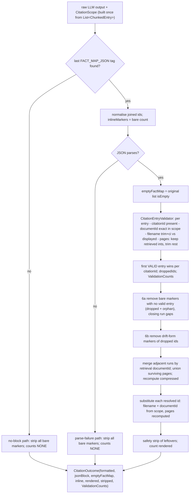
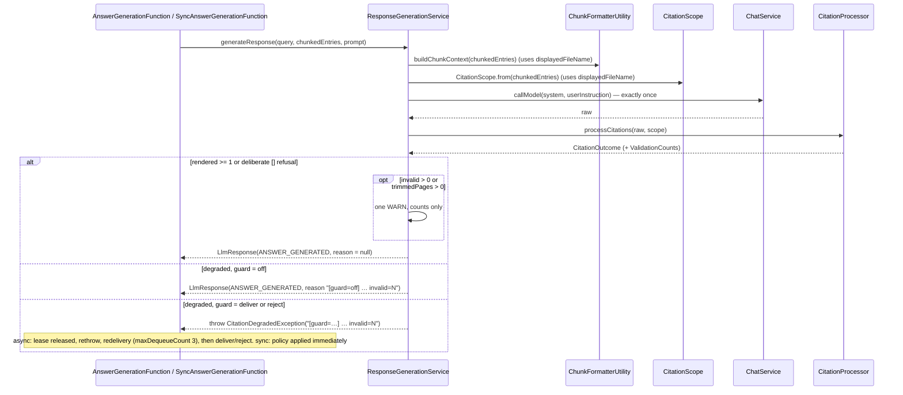

# Design: Validate LLM citations against the retrieved chunks (DD-43809)

> Stage 02 pipeline artefact (architecture-designer). Based on the code at `main @ 6586408c` on branch `dev/feature-DD-43809-citation-validation`; each element names a real class or file. Inputs: `docs/pipeline/DD-43809-citation-validation/00-input-brief.md` (agreed behaviour, PO 2026-10-20) and `01-requirements.md` (FR-1…FR-18, NFR-1…NFR-9, E-1…E-18, AC-1…AC-37, OQ-1…OQ-7 resolved). Decisions already recorded there are not reopened. Feeds story-writing and TDD implementation.

## Summary

`CitationProcessor` will check every `<FACT_MAP_JSON>` entry against the chunks that were actually retrieved and sent to the model for that answer. The input is a small immutable `CitationScope` (documentId → displayed filename + retrieved page set), built once per answer from `List<ChunkedEntry>`. The rule that picks the displayed filename becomes one public static method on `ChunkFormatterUtility`, so the prompt builder and the validator use the same code. Invalid entries are dropped and invalid pages trimmed. Markers of ids with no valid entry are removed **before** run detection, so same-document runs merge across the gap. Kept citations render the documentId, filename and recomputed pages from retrieval. If nothing renders, the answer goes through the **existing** citation guard, with `invalid=N` added to the reason. Partial invalidity is accepted with no reason and gets exactly one counts-only WARN, emitted by `ResponseGenerationService`.

**No trigger, binding, queue, table schema, blob, env var, HTTP contract or idempotency/guard mechanic changes.** The change is in-process post-processing inside `ai-document-answer-retrieval-function`, one static helper in `ai-document-shared-artefacts`, and the offline harness.

---

## Verified code baseline (what the design must fit)

| Concern | Real code today | Change vector |
|---|---|---|
| Post-processing entry | `CitationProcessor.processCitations(String)` / `processAndFormatCitations(String)` (chunk-less) | Both require a `CitationScope` (FR-15) |
| Rendering | `substituteCitation` / `formatMergedCitation` read `documentFilename`, `documentId` and pages straight from the model JSON, falling back to `UNKNOWN_FILE` / `UNKNOWN_ID`; `resolveCompressedPages` uses the model's `pageNumbers` when present | Render from scope; recompute compressed pages every time (OQ-2); remove the fallbacks (FR-6) |
| Merge | `mergeSameDocumentRuns` → `buildRunReplacement` groups by the model's raw `documentId`; an id with no entry splits a run; INFO line logs `documentId={}` | Group by validated scope documentId; unresolvable markers removed before run detection (FR-18); INFO line loses the documentId (FR-17) |
| Outcome | `CitationOutcome(formattedText, jsonBlockPresent, emptyFactMap, inlineMarkers, renderedCitations, strippedMarkers)`, nested in `CitationProcessor` | Gains `ValidationCounts` (FR-13) |
| Guard | `ResponseGenerationService.toGuardedResponse(raw)` → `isAcceptable` (rendered ≥ 1, or block present + `[]` + no markers); reason `"[guard=%s] Citations missing: jsonBlock=%s, inlineMarkers=%d, rendered=%d, stripped=%d"` | Pass the scope; append `, invalid=%d`; add the partial-invalidity WARN. `isAcceptable` unchanged |
| Chunks in hand | `ResponseGenerationService.generateResponse(userQuery, chunkedEntries, prompt)` already holds the exact list passed to `chunkFormatterUtility.buildChunkContext` | Build the scope from that same list (FR-1, A-2) |
| Displayed filename | `ChunkFormatterUtility.buildChunkContext` groups with `groupingBy(ChunkedEntry::documentId)` (HashMap document order, encounter order within each list), first chunk → private `extractMaterialName` (`material_name`, non-blank) else `documentFileName` | Extract a `public static displayedFileName(ChunkedEntry)`. Prompt bytes stay identical (scoring's `ScoringService` uses the same builder) |
| Callers of the exception | `AnswerGenerationFunction` (async, redelivery → deliver/reject at exhaustion, `e.getMessage()` is the reason) and `SyncAnswerGenerationFunction` (immediate policy) | **No change.** The reason string is opaque to them |
| Reason surface | `GetAnswerGenerationResultFunction:150` `asyncResponse.setReason(...)`, an existing free-text field | Value gains `, invalid=N`; no schema change |
| Harness | `CitationMetrics.compute(LlmResponse)` reruns a static `CitationProcessor` on the raw text; `TestHarness.computeCompliance` memoises per response (`IdentityHashMap`); `RunResult(…, LlmResponse, TokenUsage, durationMs, error)`; `RunResultStore.metricsOf` writes a `metrics` map; `BaselineJudgeTool.rowsOf` reads only `rawResponse` / `formattedResponse` / labels via `JsonNode` | Compute `Compliance` with chunks in `runCell`, carry it on `RunResult`, persist the new counts (OQ-6) |

---

## Pattern & Rationale

Rubric bucket: **"new capability inside an existing function's domain → extend that module"**, plus **"reusable rule across modules → `ai-document-shared-artefacts`"** for only the displayed-filename rule.

- **No new trigger or binding.** No `@FunctionName` is added or changed. Sync (`AnswerRetrieval`) and async (`InitiateAnswerGeneration` → `AnswerGeneration` worker → `GetAnswerGeneration`) keep their invocation modes. Validation runs inside `ResponseGenerationService.generateResponse`, which both paths already share, so both get it identically.
- **Sync vs async: not applicable.** Validation is pure, deterministic and in-process (< 5 ms, NFR-5). Nothing here justifies a queue hop.
- **Where the code lives:**
  - `CitationScope` is a model used only by `CitationProcessor`, so it goes in **`ai-document-answer-retrieval-function`** (`uk.gov.moj.cp.retrieval.model`). The harness already depends on that module (it imports `CitationProcessor` and `LlmResponse`).
  - The **displayed-filename rule** is the only thing both modules must agree on. It goes in shared artefacts, next to its existing user `ChunkFormatterUtility` (FR-8).

---

## Contract Impact

**Internal only. No contract change** (NFR-1, AC-36).

- `api-cp-ai-rag` spec, generated `uk.gov.hmcts.cp.openapi` models, status codes and `answerGenerationStatus` are all untouched.
- `CITATION_FORMAT` (`::(Source: [%s], Pages %s|%s|documentId=%s)`) is unchanged. Two observable *value* changes stay inside the existing free-text answer string:
  1. Single-entry citations now render `individualPageNumbers` normalised: ascending, de-duplicated, comma-joined with no spaces (e.g. a model's `"3, 2"` renders `2,3`). Merged citations already use this form, so consumers already parse it.
  2. The filename renders as the retrieval value, so its casing can differ from the model's echo (R-5).
- The async status response's existing `reason` field gains a trailing `, invalid=N` on degraded answers. The prefix `[guard=<mode>] Citations missing:` is unchanged. ragEval only tests for a non-blank reason, so it is unaffected.

`api-contract-check` does not need rerunning (no endpoint touched). Run it anyway if the PR template requires it.

---

## Components

| Module | Component | Change |
|---|---|---|
| `ai-document-shared-artefacts` | `uk.gov.moj.cp.ai.util.ChunkFormatterUtility` | **Add** `public static final String MATERIAL_NAME_METADATA_KEY = "material_name"` and `public static String displayedFileName(ChunkedEntry firstChunkOfDocument)`. `buildChunkContext` calls it; output is byte-identical |
| `ai-document-answer-retrieval-function` | **New** `uk.gov.moj.cp.retrieval.model.CitationScope` (+ nested `CitableDocument`) | Immutable per-answer validation scope |
| | **New** `uk.gov.moj.cp.retrieval.service.CitationEntryValidator` (package-private, stateless) | Per-entry validation, first-valid-wins, counts. Kept separate so `CitationProcessor` stays under Sonar's cognitive-complexity limit and each rule is unit-testable |
| | `uk.gov.moj.cp.retrieval.service.CitationProcessor` | New scope-taking API; new pipeline order; fallbacks removed; `CitationOutcome` + new nested `ValidationCounts`; merge INFO line without documentId |
| | `uk.gov.moj.cp.retrieval.service.ResponseGenerationService` | Builds the scope once, passes it, appends `invalid=N`, emits the single partial-invalidity WARN |
| | `uk.gov.moj.cp.retrieval.exception.CitationDegradedException` | Javadoc only (adds "every citation entry failed validation") |
| | `AnswerGenerationFunction`, `SyncAnswerGenerationFunction` | **No change** |
| `ai-document-system-prompt-harness-eval` | `CitationMetrics`, `TestHarness` (`RunResult`, `runCell`, report printers), `RunResultStore`, `README.md` | Chunk-aware compute; `Compliance` gains `invalidCitations` and `trimmedPages`; computed once in `runCell` and carried on `RunResult`; persisted |

---

## Decision 1 — The citation scope (FR-1, FR-8, E-1, E-2, E-9, E-17, OQ-5)

### Shape

```java
package uk.gov.moj.cp.retrieval.model;

/** Per-answer, immutable view of what the model was shown: documentId → displayed filename + retrieved pages. */
public record CitationScope(Map<String, CitableDocument> documents) {

    public CitationScope { documents = Map.copyOf(documents); }

    public static CitationScope empty() { … }

    /** Built once from the exact chunk list rendered into <RETRIEVED_DOCUMENTS>. null/empty → empty(). */
    public static CitationScope from(List<ChunkedEntry> chunks) { … }

    /** Exact, case-sensitive key lookup (FR-2). null → empty. */
    public Optional<CitableDocument> document(String documentId) { … }

    public record CitableDocument(String documentId, String displayedFileName, SortedSet<Integer> pages) {
        // compact ctor: pages = Collections.unmodifiableSortedSet(new TreeSet<>(pages))
        /** FR-3: candidate trimmed, case-insensitive vs the displayed name (also trimmed). null/blank → false. */
        public boolean matchesFileName(String candidate) { … }
    }
}
```

`from(chunks)` rules:
1. Iterate chunks **in list (retrieval) order**. Skip chunks with a null or blank `documentId`. This is defensive only: `buildChunkContext`'s `groupingBy` would already have thrown on a null key before the LLM call.
2. The **first chunk seen** for a documentId sets the displayed name via `ChunkFormatterUtility.displayedFileName(chunk)`. Use `containsKey` and then `put`, **not** `putIfAbsent` / `computeIfAbsent`. Both of those treat a null value as absent and would let a later chunk's name win, which would diverge from the prompt (the prompt always uses the first chunk, even if its name is null).
3. Pages are the union of non-null `pageNumber` across that document's chunks (E-9; AC-33: pages {2, null} → {2}).
4. A document is **omitted** (uncitable) when its displayed name is null or blank (OQ-5) or its page set is empty (E-9, AC-32). An entry naming it then fails the documentId check.

The record has value equality (`Map.copyOf`, plus `TreeSet` contents), so tests can verify `processCitations(raw, CitationScope.from(chunks))` with `eq` (AC-1).

### Shared displayed-filename rule (FR-8, AC-16)

```java
// ai-document-shared-artefacts — ChunkFormatterUtility
public static final String MATERIAL_NAME_METADATA_KEY = "material_name";

/** The filename shown to the model for the document whose FIRST retrieved chunk is {@code firstChunkOfDocument}:
 *  the non-blank material_name custom-metadata value, else documentFileName (may be null). */
public static String displayedFileName(final ChunkedEntry firstChunkOfDocument) { … }
```

`buildChunkContext` replaces `extractMaterialName(first).orElse(first.documentFileName())` with `displayedFileName(first)`. `extractMaterialName` becomes a private static helper. **Document grouping and order in the prompt are deliberately not changed**: the HashMap order from `groupingBy` stays, so prompt bytes are identical for the retrieval and scoring functions and harness baselines stay comparable.

The method is **static** on purpose. `ResponseGenerationServiceTest` mocks the `ChunkFormatterUtility` instance, and a static call is not affected by that mock, so `CitationScope.from` behaves the same in tests and in production.

"First chunk per document" is kept in step by both sides iterating in encounter order. `groupingBy` lists keep encounter order, so the first element is the first chunk in retrieval order. An agreement test (AC-16) pins this: it parses `DOCUMENT_FILENAME="…"` from `buildChunkContext` output and compares it with `CitationScope.from(sameList)` for `material_name` present, blank, absent, and differing across chunks.

### Who builds it

`ResponseGenerationService.generateResponse` builds it once, after the empty-chunks short-circuit:

```java
final CitationScope scope = CitationScope.from(chunkedEntries);
… .map(raw -> toGuardedResponse(raw, scope))
```

The harness builds it inside `CitationMetrics.compute` from the run's chunks. Neither caller passes raw chunks into the processor.

**Alternatives considered:**
- `CitationScope` in shared artefacts: rejected, since only retrieval and the harness consume it, and the harness already depends on retrieval.
- Processor takes `List<ChunkedEntry>` and builds the scope itself: rejected, because the processor would then depend on the chunk model's shape, and the "built once" point would be implicit.
- Sharing a whole `chunksByDocument` grouping helper: rejected, because changing `buildChunkContext`'s grouping risks prompt-byte drift for no gain over the agreement test.

---

## Decision 2 — Public API change and migration list (FR-15)

```java
public CitationOutcome processCitations(String rawLlmOutput, CitationScope scope);
public String processAndFormatCitations(String rawLlmOutput, CitationScope scope); // = processCitations(...).formattedText()
```

- The single-argument overloads are **removed**, so AC-3 is enforced at compile time.
- `processAndFormatCitations` is kept, now requiring a scope. That makes the test migration of about 60 call sites mechanical (`(raw)` → `(raw, SCOPE)`).
- `scope == null` is treated as `CitationScope.empty()`: every entry is invalid, never "skip validation" (AC-2).

### Call-site migration (complete; from grep at `6586408c`)

| File | Sites | Change |
|---|---|---|
| `ai-document-answer-retrieval-function/.../service/ResponseGenerationService.java` | 1 (`toGuardedResponse`) | Pass the scope (built once in `generateResponse`) |
| `ai-document-system-prompt-harness-eval/.../harness/CitationMetrics.java` | 1 (`OUTCOME_PROCESSOR.processCitations(raw)`) | `compute(LlmResponse, List<ChunkedEntry>)` → `processCitations(raw, CitationScope.from(chunks))` |
| `ai-document-system-prompt-harness-eval/.../harness/TestHarness.java` | `buildService` (`new CitationProcessor()`, unchanged); `computeCompliance` + `COMPLIANCE_BY_RESPONSE` + 4 readers (`printSummary`, `computeCellStats`, `printRunDetail`, `RunResultStore.persist`) | Compute `Compliance` once in `runCell` (chunks in scope) and store it on `RunResult`; delete the identity-map memo; readers use `r.compliance()` |
| `.../harness/RunResultStore.java` | `metricsOf(TestHarness.computeCompliance(...))` | `metricsOf(r.compliance())` + new keys |
| Tests: `CitationProcessorTest` (5), `CitationProcessorMergeTest` (13), `CitationProcessorGpt41Test` (21), `CitationProcessorGpt51Test` (5), `CitationProcessorDriftTest` (4), `CitationOutcomeTest` (8 + 1 delegate), `ResponseGenerationServiceTest` (stubs and verifies at L99, L110, L143, L239, L259, L278, L299, L317; outcome constructors at L63, L67, L260, L318; reason asserts in two tests), `CitationMetricsTest` (`compute` helper), `ResponseQualityComparatorTest` (5 `new RunResult(...)` sites) | See Test strategy |
| `AnswerGenerationFunctionTest`, `SyncAnswerGenerationFunctionTest` | Literal `Citations missing: …` strings passed into a hand-built `CitationDegradedException` | **No change required.** They don't go through `ResponseGenerationService`. Optionally refresh the literals to show `, invalid=0` |

### Harness: `RunResult` and persisted counts (OQ-6, FR-14, E-18)

- `record RunResult(…, LlmResponse response, TokenUsage usage, long durationMs, String error, CitationMetrics.Compliance compliance)`. `compliance` is null when `response` is null (SKIPPED/ERROR).
- `runCell` calls `CitationMetrics.compute(r, chunks)` straight after `generateResponse`, using the same chunk list. This reproduces the production `CitationOutcome` exactly, because processing is deterministic over the same raw text and scope.
- Exposing the real outcome through `LlmResponse` was rejected: it would widen a production record that is persisted and threaded through both functions, just for an offline tool.
- `Compliance` gains `int invalidCitations, int trimmedPages`, read from the outcome. `renderedCitations` and `strippedMarkers` keep coming from the same outcome, so they now match production (AC-35).
- `RunResultStore.metricsOf` adds `"invalidCitations"` and `"trimmedPages"`. `meta` adds `"citationValidation": true` so a file identifies itself as produced with validation.
- **Backward compatibility with older stored run JSON:** nothing deserialises `RunResult`; persisted files are only read as `JsonNode`. The only reader today, `BaselineJudgeTool.rowsOf`, reads `rawResponse` / `formattedResponse` / labels / `status` / `durationMs` / `error` and **never** `metrics`, so old and new files both load. Rule for any current or future reader: absent `metrics.invalidCitations` / `trimmedPages`, or absent `meta.citationValidation`, means **"not measured"** (print `n/a`), never 0, because those runs rendered citations without validation. The record is written only in-process, so no Jackson annotations or defaults are needed.
- `ResponseQualityComparatorTest`: add a trailing `null` at the 5 `new RunResult(...)` sites. A secondary 8-argument constructor was rejected because it would hide the new field.

---

## Decision 3 — Internal pipeline order (FR-5, FR-9, FR-10, FR-16, FR-18)

### Steps

0. `scope = scope == null ? CitationScope.empty() : scope`. Empty or blank input → empty outcome with `ValidationCounts.NONE`, as today.
1. **Find the last tag.** None → the existing no-block path (normalise joined ids, strip all bare markers, existing WARN). `ValidationCounts.NONE`.
2. **Normalise joined ids** in the answer text. `inlineMarkers = countBareMarkers(answerText)`, measured **before any removal** (unchanged meaning).
3. **Parse** the JSON into `List<Map<String,Object>> entries`. Failure → the existing parse-failure path (`jsonBlock=true`, rendered 0, all bare markers stripped). `ValidationCounts.NONE` (AC-25: a degraded answer with nothing dropped carries `invalid=0`).
4. **`emptyFactMap = entries.isEmpty()`** on the **original** parsed list (FR-10). Never recomputed on the filtered list.
5. **Validate** with `CitationEntryValidator.validate(entries, scope)`, entries in order:
   - The citationId key is `stringifyJsonValue(citationId)` then trimmed, so `1` and `"1"` are the same key (E-7). Missing or blank → invalid, cause `noCitationId` (OQ-1, E-12).
   - `documentId`: the value must be a JSON string, and `scope.document(value)` must be present with an **exact** key match (no trim or case folding; AC-5). Otherwise cause `documentId`.
   - `documentFilename`: `doc.matchesFileName(value)`, i.e. trimmed and case-insensitive against **that** document's displayed name (E-1, E-3, AC-7…AC-9). Otherwise cause `filename`.
   - `individualPageNumbers`: stringify (a JSON array joins with `,`; E-6), split on `,`, trim, drop empties, then `Integer.parseInt`.
     - A token is kept iff it parses **and** is in `doc.pages()`.
     - Non-numeric (`iv`, `N/A`, `2-3`, `7.0`) or not retrieved for this document → trimmed (E-4, E-5, AC-10, AC-11, AC-14).
     - Duplicate surviving tokens are de-duplicated and are not counted as trimmed.
     - No surviving page → invalid, cause `pages` (AC-13).
   - **First valid wins** (FR-16): `resolvedById.putIfAbsent(id, ResolvedCitation(id, doc, survivingPages, trimmed))` for valid entries only. Invalid duplicates are counted. Valid duplicates after the first are **shadowed**: they are not counted as invalid and their trims are not counted (AC-30, AC-31).
   - `droppedIds` = ids that appear on ≥ 1 entry, minus `resolvedById.keySet()`.
   - The model's `pageNumbers` field is **ignored** (OQ-2). The model's `documentId` and `documentFilename` are never rendered (FR-7).
6. **Remove unresolvable markers before run detection** (FR-5, FR-18):
   - **6a. Bare markers.** Scan with a bounded pattern `([ \t]{0,3})\[(\d{1,9})\]`. A marker whose id is **not** in `resolvedById` is removed. If the character before its leading whitespace is `]` (it sits inside a marker run), that separating whitespace (≤ 3 chars) is removed too, so the surviving neighbours stay a run that `MARKER_RUN_PATTERN` (`{0,3}` gap) still matches. Example: `[1] [2] [3]` with `[2]` dropped → `[1] [3]`. Elsewhere only the marker is removed, which matches today's strip behaviour (`Text [2].` → `Text .`). Removed markers are counted as `droppedMarkers` (id in `droppedIds`) or `orphanMarkers` (id on no entry at all).
   - **6b. Drift forms of dropped ids.** For each id in `droppedIds`, remove every remaining occurrence matched by `PLACEHOLDER_REGEX_TEMPLATE` (`[2 p.7]`, `[Source 2]`, `[^2]`, `[ 2 ]`, …) and count them. Without this, those forms would previously have been *substituted*, and would now leak into the answer as literal brackets.
   - Orphan ids in drift form (`[Source 9]` with no entry) are left verbatim, **as today**. Unchanged and out of scope.
7. **Merge same-document runs** (`mergeSameDocumentRuns`). Every bare marker left now resolves, so runs group by `resolved.document().documentId()`, the **retrieval** id. A merged citation renders the scope's displayed name, the **union of surviving pages** (an integer `TreeSet`), and `compressPageRange` of that union (AC-17, AC-18, AC-19).
8. **Substitute** each `resolvedById` entry, one per id (not each raw entry), using `PLACEHOLDER_REGEX_TEMPLATE`. Render: `formatCitation(doc.displayedFileName(), compressPageRange(join(pages)), join(pages), doc.documentId())` (AC-15). Pages are always recomputed (OQ-2).
9. **Final safety strip**: the existing `stripUnresolvedCitationMarkers(text, false)`. With step 6 this normally finds nothing. Any leftover is still counted and stripped as before.
10. `renderedCitations = countRenderedCitations(formatted)` (unchanged).

Removal of the fallbacks: `UNKNOWN_FILE` / `UNKNOWN_ID` are deleted and `resolveCompressedPages` is deleted. `unionPages` and `addPageToken` simplify to an integer union (the non-numeric branch can no longer be reached). `CitationKeys.PAGE_NUMBERS` stays as a documented key of the model's JSON schema but is no longer read. `compressPageRange` is unchanged.

The existing `catch (Exception e)` around parsing and post-processing stays as the resilience net. An unexpected failure after validation degrades to the parse-failure outcome (rendered 0, `ValidationCounts.NONE`), so it goes through the guard and is never silently delivered unvalidated.

### Decision: orphan bare markers are removed in step 6 too

"Ids with no valid entry" covers ids with **no entry at all** as well as ids whose entries were all invalid. Step 6a therefore removes both kinds of bare marker before run detection. The visible effect is that `[1][9][2]` (no entry for 9; 1 and 2 valid, same document) now merges into one citation instead of two. That changes one pinned test (`CitationProcessorMergeTest.unknownIdInsideRun_BreaksMergeAndIsStripped`).

- **Why:** one uniform rule ("only resolvable markers take part in a run"), no asymmetry between "garbled entry" and "missing entry", and a single removal pass.
- **Rejected alternative:** keep orphans splitting runs. Today's behaviour, but two code paths for the same reader-visible situation.
- **Reversible:** a one-line predicate change. Listed as a confirmation question below.

### Counts: exact meaning after this change

| Field | Meaning | Changed? |
|---|---|---|
| `inlineMarkers` | Bare `[N]` markers in the answer text after joined-id normalisation, **before** any removal, merge or substitution | Unchanged |
| `renderedCitations` | `::(Source: [` occurrences in the formatted text (a merged run counts as 1; an id used twice counts twice). Only validated citations can now render | Meaning unchanged; values exclude invalid entries |
| `strippedMarkers` | Marker occurrences removed **without being rendered**: bare markers of dropped ids (6a) + bare orphan markers (6a) + drift forms of dropped ids (6b) + any leftovers from the safety strip (9). On the no-block and parse-failure paths: all bare markers (unchanged) | Widened. **Numerically identical to today whenever `invalidEntries == 0`** (orphans were already counted, as leftovers). Can exceed `inlineMarkers` only when drift-form markers of dropped ids are present |
| `ValidationCounts.factMapEntries` | Parsed entries in the original list (0 on no-block / parse-failure) | New |
| `ValidationCounts.invalidEntries()` | **Entries** (not markers, not ids) that failed validation, including no-citationId entries. Equals `noCitationId + documentId + filename + pages` (one cause per entry, first failing check in that order). Valid-but-shadowed duplicates are not counted | New → `invalid=N` |
| `ValidationCounts.trimmedPages` | Page tokens removed from the **winning** (rendered-eligible) entries. Tokens of dropped entries are not counted (the entry is counted instead) | New |

Invariants (asserted in tests):
- `stripped == 0 && invalid == 0` ⇒ every bare marker rendered.
- `jsonBlock && !emptyFactMap && rendered == 0` ⇒ degraded (AC-14, AC-20).
- `isAcceptable` **is not modified**.

---

## Decision 4 — `CitationOutcome`, guard reason, logging (FR-11, FR-12, FR-13, FR-17)

```java
public record CitationOutcome(String formattedText, boolean jsonBlockPresent, boolean emptyFactMap,
                              int inlineMarkers, int renderedCitations, int strippedMarkers,
                              ValidationCounts validation) {
    public int invalidEntries() { return validation.invalidEntries(); }
    public int trimmedPages()   { return validation.trimmedPages(); }
}

public record ValidationCounts(int factMapEntries, int noCitationId, int invalidDocumentId,
                               int invalidFileName, int noValidPage, int trimmedPages) {
    public static final ValidationCounts NONE = new ValidationCounts(0, 0, 0, 0, 0, 0);
    public int invalidEntries() { return noCitationId + invalidDocumentId + invalidFileName + noValidPage; }
}
```

Both stay nested in `CitationProcessor`, keeping the existing import `CitationProcessor.CitationOutcome`.

### Guard reason (degraded only)

```
[guard=%s] Citations missing: jsonBlock=%s, inlineMarkers=%d, rendered=%d, stripped=%d, invalid=%d
```

The field is appended, so the prefix stays stable. `invalid=0` appears on every degraded answer where nothing was dropped (AC-25). The `[guard=…]` prefix is untouched (AC-21, AC-23).

### Logging (single WARN, counts only)

**Placement: `ResponseGenerationService`, not `CitationProcessor`.** Reasons:
1. Only the guard knows the answer was **accepted**, which is what separates "partial" from "degraded". In the degraded case the guard WARN already carries `invalid=N`, so no second WARN is emitted.
2. The harness calls `CitationProcessor` directly for metrics. A WARN in the processor would double-log on every harness cell.
3. The processor stays a pure transformer with diagnostic-only logging.

When accepted and `renderedCitations ≥ 1 && (invalidEntries > 0 || trimmedPages > 0)`:

```java
LOGGER.warn("Citation validation: answer accepted after removing invalid citations — entries={}, invalid={} "
        + "[causeCitationId={}, causeDocument={}, causeFilename={}, causePages={}], trimmedPages={}, rendered={}", …);
```

- No documentId, filename, page values, query or answer text (NFR-4, AC-27). Correlation comes from MDC `txn=` / `inv=`.
- Cause labels deliberately avoid the literal token `documentId=`, so log-hygiene greps and Kusto searches for `documentId=` stay clean.
- `LlmResponse.reason` stays **null** (FR-12, AC-26, AC-28).

Other log changes:
- The existing accepted INFO line in `toGuardedResponse` appends `invalid={}, trimmedPages={}`. Still INFO, counts only.
- `CitationProcessor.appendGroup` INFO becomes `"Merged {} adjacent same-document citation markers {} into one citation"` with no documentId (AC-29). Citation ids are model-local ordinals, not identifiers, so they stay.
- `CitationProcessor` emits **no WARN** for validation drops (at most a DEBUG with counts). Its existing WARNs are unchanged in wording and fire only for:
  - orphan bare markers (6a, `orphanMarkers > 0`: "…had no matching JSON citation entry…");
  - catastrophic runs (> 100 markers removed in 6a);
  - no block;
  - parse failure.

  So in the AC-26 scenario (no orphans) the answer produces exactly one WARN in total.

---

## Data & Flow

- **Queues:** unchanged. `STORAGE_ACCOUNT_QUEUE_ANSWER_GENERATION` and `STORAGE_ACCOUNT_QUEUE_ANSWER_SCORING` payloads are unchanged.
- **Table (`STORAGE_ACCOUNT_TABLE_ANSWER_GENERATION`):** no schema or key change (PartitionKey/RowKey stay `transactionId`-based; client-scoping unchanged). The only difference is the *value* of the existing reason column on degraded rows (`…, invalid=N`). Partial invalidity writes no reason. Terminal and non-terminal statuses are unchanged.
- **Blob:** the answer payload blob is unchanged in shape. `formattedLlmResponse` now carries only validated citations.
- **Scoring:** receives the (now validated) formatted answer as before. Prose is unchanged; only citation strings differ. Groundedness scoring is not expected to shift materially.

---

## Diagrams

### Post-processing pipeline (inside `CitationProcessor.processCitations(raw, scope)`)



### Guard sequence (both invocation modes; mechanics unchanged)



---

## Reliability

- **Idempotency:** unchanged. `IdempotencyGuard.runOnce(transactionId, work)` wraps the same pipeline. Validation is inside `work` and adds no I/O. Terminal-row skip, ETag fencing and lease semantics are untouched.
- **Redelivery:** unchanged mechanism. Answers that **now** correctly fail (all citations invalid) take the existing path: lease released before the `CitationDegradedException` rethrow, fresh attempt (re-embed → re-search → one LLM call), up to `maxDequeueCount` 3, then `CITATION_GUARD_MODE`. Each attempt validates against **its own** retrieval (E-16). Nothing about the scope is persisted between attempts.
- **Lease-TTL invariant:** unaffected. Validation adds < 5 ms to an attempt, against `IDEMPOTENCY_LEASE_TTL_SECONDS` (300) < `visibilityTimeout × (maxDequeueCount − 1)` (5 min × 2).
- **Poison / exhaustion:** unchanged (deliver → persist + score with reason; reject → FAILED row; live-lease exhaustion → WARN and leave).
- **Determinism:** pure function of (raw, scope). No randomness, no model calls (AC-37).

---

## Cross-cutting

- **Auth (managed identity):** no new client or credential path.
- **New env vars:** **none** (NFR-2). Nothing is added to any `local.settings.sample.json` or the CLAUDE.md env-var list. Validation is always on.
- **Validation of inputs:** model JSON is treated as untrusted. Non-string `documentId`, non-numeric pages and missing fields are all handled as invalid without exceptions. Joined-id normalisation and bounded regexes stay S5852-safe; any new pattern uses bounded quantifiers.
- **Logging:** SLF4J → log4j2, MDC correlation per `docs/transaction-scoped-logging.md`. No IDs, names or text in messages (FR-17, NFR-4).

### Documentation updates (exact)

1. **`CLAUDE.md` → "Key environment variables" → citation-guard bullet (`CITATION_GUARD_MODE`):**
   - In the degraded definition "(no `<FACT_MAP_JSON>` block, unparseable JSON, or every inline marker stripped)", add: "…or **every FACT_MAP_JSON entry failed validation against the retrieved chunks**, so no citation rendered".
   - Add one sentence on validation: each entry is validated against the chunks sent to the model (documentId exact; filename trimmed and case-insensitive against the displayed name, `material_name` else `documentFileName` of the document's first retrieved chunk; pages must be retrieved pages of that document and invalid pages are trimmed). Invalid entries are dropped and their markers stripped, with no repair. Kept citations render documentId, filename and pages from retrieval.
   - Update the reason example to show the new trailing field: `[guard=off] Citations missing: …, invalid=N`, where `invalid` = FACT_MAP_JSON entries dropped by validation.
   - Add: "**Partial invalidity** (some entries dropped or pages trimmed, ≥ 1 citation rendered) is accepted as `ANSWER_GENERATED` with **no** reason (the reason column stays reserved for real degradation, which ragEval gates on) and logs a single counts-only WARN."
   - State explicitly that there is no new env var and no change to retry, lease or exhaustion mechanics.
2. **`CLAUDE.md` → "Query & Answer Generation Pipeline":** add one line under the sync/async descriptions saying citation post-processing validates against the retrieved chunks (link to this design).
3. **`docs/transaction-scoped-logging.md`:**
   - Line ~190: remove "`CitationProcessor`'s merge line (the *cited* document, not the journey's)" from the statements that keep an ID. It no longer logs one.
   - Line ~150 example: optionally append `, invalid=0` to the sample reason.
4. **Javadoc:** `CitationProcessor` class Javadoc (add a "Validation" bullet; update the merge bullet to "groups by the validated retrieval documentId"; note markers of ids with no valid entry are removed before run detection); `CitationDegradedException`; `ResponseGenerationService.generateResponse` and `toGuardedResponse`; `CitationMetrics` (now "pure function of the response **and its chunks**").
5. **`ai-document-system-prompt-harness-eval/README.md` metrics table:** add `invalid` / `trimmed` rows. Update `rendered` / `stripped` to say "stripped includes markers of citations dropped by validation". Note that pre-DD-43809 result files carry no validation counts ("n/a").

---

## Risks & Trade-offs

1. **Higher degraded and redelivery rate (operational, R-1).** Answers that used to pass with broken links now fail the guard: more async attempts, and under `reject` more FAILED rows. The failure mode is intermittent, so a redelivery usually recovers it. *Mitigation:* `invalid=N` in the reason column, the partial WARN, harness `invalid` counts before release; a post-release App Insights query on the WARN (OQ-7 follow-up).
2. **Strictness drops near-miss citations (R-2, R-3).** A model that cites an adjacent page, drops an extension or normalises punctuation loses that page or entry. This is accepted under "no repair". *Mitigation:* the WARN's cause breakdown plus harness `trimmed` / `invalid` columns. A prompt-side fix is a follow-up, not this change.
3. **Prompt/validator drift (technical, FR-8).** If someone changes `buildChunkContext`'s filename selection without the shared method, the validator would reject correct echoes. *Mitigation:* the single static rule, plus the agreement test (AC-16) that parses real `buildChunkContext` output.
4. **Rendering normalisation (minor, R-5).** Individual pages are now sorted and de-duplicated without spaces, and filename casing comes from retrieval. The format string is unchanged, and the merged form already looked like this.
5. **Harness baselines across the boundary.** `BaselineJudgeTool` comparing a pre-change file with a post-change one compares formatted text where the old side may contain unvalidated citations. The judge assesses factual parity and structure, so the effect is small. Flag it in the README.

**Reversibility:** a two-way door. Code-only, no data migration, no contract or schema change. Rollback = promote the previous retrieval release `version` in `cpp-functionapp-deployment`. Rows written in the meantime simply have a longer reason string.

---

## Alternatives Considered

- **Repair garbled ids (prefix / edit-distance / filename lookup).** Rejected by PO decision. It would also hide model regressions.
- **Validate in `ResponseGenerationService` after formatting (parse rendered strings).** Rejected: merge has already grouped by the unvalidated id (gap 3) and fallbacks have already rendered. Validation must come before merge (FR-9).
- **Processor takes `List<ChunkedEntry>` directly.** Rejected: rebuilds lookups per call, couples the processor to the chunk schema, and leaves the "built once" point implicit.
- **Partial-invalidity WARN inside `CitationProcessor`.** Rejected: the processor can't tell accepted from degraded, and the harness would double-log.
- **Expose `CitationOutcome` via `LlmResponse` for the harness.** Rejected: widens a persisted production record for an offline concern. Recomputing over identical inputs gives identical counts.
- **Derive test scopes from each fixture's own JSON (a "permissive" helper).** Rejected: it makes the tests circular and would hide validation bugs. Explicit per-class fixture scopes are used instead.
- **Keep orphan markers splitting runs.** Rejected in favour of the uniform "no valid entry" rule (see Decision 3). Easy to revert.

---

## Test strategy

### Cheap migration of existing suites

Add a test-scope fixture helper, `ai-document-answer-retrieval-function/src/test/java/uk/gov/moj/cp/retrieval/service/CitationScopeFixtures.java`:

```java
record Doc(String documentId, String fileName, int... pages) {}
static Doc doc(String documentId, String fileName, int... pages)
static List<ChunkedEntry> chunksOf(Doc... docs)   // one chunk per page, in argument order, documentFileName = fileName
static CitationScope scopeOf(Doc... docs)         // CitationScope.from(chunksOf(docs))
```

| Suite | Edits | Behaviour changes to assert |
|---|---|---|
| `CitationProcessorTest` (5) | `SCOPE = scopeOf(doc("doc123","file.pdf",10,11,12,13))`; pass the scope to null/empty calls | None (`10-12` recomputes identically). **Add** the null-scope test (AC-2) |
| `CitationProcessorMergeTest` (13) | Per-test scopes where fixtures reuse an id with different filenames (`doc123` and `docA` each appear under two different filenames) | `nonNumericPageTokens_AreToleratedInUnion` → `…AreTrimmedFromUnion` expecting `Pages 2,3\|2,3`; `unknownIdInsideRun_BreaksMergeAndIsStripped` → `unknownIdInsideRun_IsStrippedAndRunStillMerges` expecting one `Pages 1,2\|1,2` citation |
| `CitationProcessorGpt41Test` (21) | `SCOPE = scopeOf(doc("abc-123","report-a.pdf",7,8,9), doc("a-id","a.pdf",1), doc("b-id","b.pdf",2))` | `c3_missingDocumentId`: now asserts no `::(Source:`, no `UNKNOWN_ID` / `UNKNOWN_FILE`, no `[1]` (AC-6) |
| `CitationProcessorGpt51Test` (5) | `SCOPE = scopeOf(doc("abc-123","report-a.pdf",7))` | None |
| `CitationProcessorDriftTest` (4) | Same scope | None (Drift 4 takes the no-block path) |
| `CitationOutcomeTest` (8) | `SCOPE = scopeOf(doc("docA","report-a.pdf",3,7))` | Add `invalidEntries()==0`, `trimmedPages()==0` to the clean case. `strippedMarkers` values unchanged (no invalid entries) |
| `ResponseGenerationServiceTest` | Stubs → `processCitations(eq(raw), any(CitationScope.class))`; first test verifies `processCitations(raw, CitationScope.from(chunkedEntries))` (AC-1); `never().processCitations(any(), any())`; outcome constructors get `ValidationCounts.NONE`; two reason assertions gain `, invalid=0` | Add: degraded with `ValidationCounts(2,0,2,0,0,0)` → reason ends `invalid=2` (deliver throws; off returns, AC-23); accepted + invalid > 0 → reason null |
| `CitationMetricsTest` | `compute(raw, formatted)` helper gains chunks: `scopeChunks = chunksOf(doc("doc-A","f.pdf",1,2,3,4,5), doc("doc-B","f.pdf",2))` | Add AC-34 (one invalid + one valid → `invalidCitations=1`, `renderedCitations=1`) and AC-35 |
| `ResponseQualityComparatorTest` | Add a trailing `null` to the 5 `new RunResult(...)` calls | None |
| `ChunkFormatterUtilityTest` | Existing assertions stay byte-identical | Add `displayedFileName` cases: present, blank, absent, null `documentFileName` |

**Domain-neutral wording (NFR-9):** these files contain domain-specific fixture names and prose. Because every touched line is being edited anyway, neutralise them (`report-a.pdf`, `notes-b.pdf`, "The item was recorded") in a **separate mechanical commit** in the same PR, so the behavioural diff can be reviewed on its own.

### New tests

- **`CitationScopeTest`** (retrieval `model`): first chunk wins incl. a null first name (no later override); null pages ignored; uncitable documents omitted (OQ-5, E-9); null/empty list → empty; exact-key lookup; `matchesFileName` trim and case rules; immutability; value equality.
- **`CitationScopePromptAgreementTest`** (AC-16): parses `DOCUMENT_FILENAME` from `new ChunkFormatterUtility().buildChunkContext(chunks)` and compares it per documentId with `CitationScope.from(chunks)` for `material_name` present / blank / absent / differing across chunks.
- **`CitationProcessorValidationTest`**: uses the requirements fixtures A (`aaaaaaaa-0000-4000-8000-000000000001`, `report-a.pdf`, {2,3}) and B (`bbbbbbbb-0000-4000-8000-000000000002`, `notes-b.pdf`, {5}). One test per AC: AC-2, AC-4…AC-15, AC-17…AC-20, AC-25, AC-30…AC-33. Also E-13 (unreferenced invalid entry still counted), E-14, the `[1] [2] [3]` spaced-gap merge, drift-form removal of a dropped id (`[Source 2]`), and the `strippedMarkers` / `invalidEntries` invariants from Decision 3.
- **`ResponseGenerationServiceCitationValidationTest`**: real `CitationProcessor` and `ChunkFormatterUtility`, mocked `ChatService` / `UserInstructionService`. Covers AC-1 end-to-end, AC-20, AC-21 (exception message contains `invalid=2`), AC-23, AC-24, AC-26 (exactly one WARN across both loggers), AC-27 (the WARN contains none of the fixture ids / filenames / answer text), AC-28, AC-29 (merge INFO has no documentId), AC-37 (`callModel` once; identical inputs give identical output).
- **Log capture:** a small test-scope `LogCapture` (`AutoCloseable`) that attaches a log4j2 `AbstractAppender` to named loggers. log4j-core reaches the test classpath at runtime scope via `log4j-slf4j2-impl`. If the build complains, declare `log4j-core` as a test-scope dependency in the retrieval pom. There is no existing log-capture utility in the repo.
- AC-21 / AC-22 at function level are already covered by `AnswerGenerationFunctionTest` and `SyncAnswerGenerationFunctionTest`, which are message-agnostic. No change needed.
- `mvn verify` green; Sonar gate on new code. The validator split keeps `CitationProcessor` complexity in check.

---

## Implementation Outline (file by file)

- [ ] **1. Shared rule (FR-8):** `ai-document-shared-artefacts/src/main/java/uk/gov/moj/cp/ai/util/ChunkFormatterUtility.java`: add `MATERIAL_NAME_METADATA_KEY` and `public static String displayedFileName(ChunkedEntry)`; `buildChunkContext` uses it; output byte-identical. Test: `ChunkFormatterUtilityTest` additions.
- [ ] **2. Scope model:** new `ai-document-answer-retrieval-function/src/main/java/uk/gov/moj/cp/retrieval/model/CitationScope.java` (Decision 1). Tests: `CitationScopeTest`, `CitationScopePromptAgreementTest`.
- [ ] **3. Validator:** new package-private `ai-document-answer-retrieval-function/src/main/java/uk/gov/moj/cp/retrieval/service/CitationEntryValidator.java`. Returns `ValidationResult(Map<String, ResolvedCitation> resolvedById, Set<String> droppedIds, ValidationCounts counts)`; `ResolvedCitation(String citationId, CitableDocument document, SortedSet<Integer> pages, int trimmedPages)`.
- [ ] **4. Processor:** `ai-document-answer-retrieval-function/src/main/java/uk/gov/moj/cp/retrieval/service/CitationProcessor.java`:
  - replace both public methods with the scope-taking signatures (null → empty);
  - add `ValidationCounts` and extend `CitationOutcome`;
  - implement steps 4–10 (pre-run removal with run-gap closing, drift removal for dropped ids, merge by retrieval id, render from scope, pages recomputed);
  - delete `UNKNOWN_FILE`, `UNKNOWN_ID`, `resolveCompressedPages`; simplify `unionPages`;
  - remove the documentId from the merge INFO;
  - no WARN for validation drops; existing orphan / catastrophic / no-block / parse WARNs kept;
  - update the Javadoc.
- [ ] **5. Guard:** `ai-document-answer-retrieval-function/src/main/java/uk/gov/moj/cp/retrieval/service/ResponseGenerationService.java`: build `CitationScope.from(chunkedEntries)` once after the empty check; `toGuardedResponse(raw, scope)`; reason format + `invalid=%d`; accepted INFO + `invalid` / `trimmedPages`; single partial-invalidity WARN (Decision 4); Javadoc.
- [ ] **6. Exception Javadoc:** `ai-document-answer-retrieval-function/src/main/java/uk/gov/moj/cp/retrieval/exception/CitationDegradedException.java`.
- [ ] **7. Retrieval tests:** add `CitationScopeFixtures`, `LogCapture`, `CitationProcessorValidationTest`, `ResponseGenerationServiceCitationValidationTest`; migrate the six existing citation suites and `ResponseGenerationServiceTest` per the table. Separate commit: neutral wording in touched fixtures.
- [ ] **8. Harness metrics:** `ai-document-system-prompt-harness-eval/src/main/java/uk/gov/moj/cp/harness/CitationMetrics.java`: `compute(LlmResponse, List<ChunkedEntry>)`; `Compliance` + `invalidCitations`, `trimmedPages`; Javadoc.
- [ ] **9. Harness runner:** `.../harness/TestHarness.java`:
  - `RunResult` + `Compliance compliance`; `runCell` computes it with `chunks`;
  - remove `COMPLIANCE_BY_RESPONSE` / `computeCompliance` (or reduce it to `r.compliance()`);
  - `printSummary` adds `invalid` (and `rendered`) columns;
  - `CellStats` / `printConsistency` add `invalid` = OK runs with ≥ 1 invalid entry (x/n);
  - `printRunDetail` adds `invalid: {} | trimmedPages: {}`;
  - legend lines.
- [ ] **10. Harness persistence:** `.../harness/RunResultStore.java`: `metricsOf(r.compliance())` + `invalidCitations`, `trimmedPages`; `meta.citationValidation = true`. Missing-field rule documented in the class Javadoc.
- [ ] **11. Harness tests:** `CitationMetricsTest` (helper with chunks, AC-34 / AC-35); `ResponseQualityComparatorTest` (5 constructor sites).
- [ ] **12. Docs:** `CLAUDE.md` (citation-guard bullet + pipeline line, exactly as listed above); `docs/transaction-scoped-logging.md` (merge-line exception removed; optional example refresh); `ai-document-system-prompt-harness-eval/README.md` metrics table.
- [ ] **13. Verify:** `mvn verify` (all modules; the shared change ships to scoring too, byte-identical prompt); Sonar gate. Integration tests are optional; if run, notify Mahesh first so RBAC can be enabled.

No env vars, no `local.settings.sample.json` changes, no `host.json` changes, no spec PR.

---

## Rollout

- A single PR. Every merge to `main` cuts a release. Promote the answer-retrieval function `version` in `hmcts/cpp-functionapp-deployment` (`vars/<env>/ccm01-airag.tfvars`) with no settings change.
- The scoring function gets the shared-artefacts change, but its behaviour is byte-identical, so promoting it is optional.
- Before releasing: run the harness on a retrieval snapshot to baseline `invalid` / `trimmed` rates per model.
- After deployment: rerun ragEval (`cpp-ui-e2e-serenity`) and watch the guard WARNs, `invalid=` in the reason column and the partial-invalidity WARN on dev/ste.

## Follow-ups

- **ADR recommended?** No. This hardens an existing component inside the established guard design; this document plus the CLAUDE.md update is enough.
- App Insights saved query / alert on the partial-invalidity WARN (OQ-7, outside this repo).
- Optional system-prompt tweak to reduce id transcription errors (out of scope here; measure with the harness first).
- DD-43838 (`[]`-refusal loophole) stays separate.
- Deployment note: out of scope here (manual ADO pipeline after merge).

## Remaining questions

None. Orphan-marker handling (Decision 3) confirmed by the product owner on 2026-10-20: the uniform rule applies, so `[1][9][2]` merges into one citation.
## Post-review revisions

The design above is what was reviewed. Code review and a simplification pass then changed these points. The implementation follows this section where the two differ.

- **Two passes replace Decision 3 steps 6–9.**
  1. **Clean** the answer against the validated entries. A marker of a valid entry, bare or drift form (`[Source 2]`, `[2 p.3]`), becomes a bare `[N]`. A bare marker with no valid entry, or a drift form of a dropped id, is removed, together with its gap when it sits inside a run.
  2. **Render** each run of bare markers as one citation per consecutive same-document group.

  Rendering is the last pass over the text, so a displayed filename that looks like a marker (`12345`, `2 notes.pdf`, `[1]`) is never re-read, and no placeholder mechanism is needed. `renderedCitations` is counted as citations are written. The post-substitution safety strip is removed because it could never fire. `[1][9][2]` and `[1] [2 p.3] [3]` (2 dropped) still merge into one citation. Drift forms of valid ids now merge like bare markers: `[1] [Source 2]` citing one document gives one citation.
- **Citation ids are numeric only (`\d{1,9}`).** A non-numeric `citationId` is an invalid entry. The cause is renamed from `noCitationId` to `invalidCitationId`, and text like `[a]` stays as prose. The same id fragment is shared by every marker pattern and by page parsing. Nine digits always fit an `int`.
- **Pages:** every value, including JSON array elements, is split on `,`, so `["2,3"]` reads as pages 2 and 3. `compressPageRange` takes the sorted integer pages.
- **Types:** `ValidationCounts` moved to `uk.gov.moj.cp.retrieval.model`, which breaks the validator↔processor cycle. `CitationScope.CitableDocument.pages` is a plain `Set`. `ResolvedCitation` no longer carries the citationId. `processAndFormatCitations` was removed.
- **Logging:** the no-block / parse-failure WARN now reads "N inline [N] marker(s) came with no usable <FACT_MAP_JSON> block…". A null JSON payload takes the parse-failure path without an exception.
