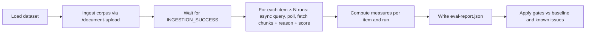

# Design: Standalone end-to-end evaluation suite (DD-43887)

> Stage 02 pipeline artefact — **DRAFT for discussion**. Based on `main @ 9392d3ab`.
> Input: `00-input-brief.md`. A formal `01-requirements.md` has not been written; the
> decisions below marked **(proposed)** and the open questions at the end stand in for it
> until agreed.

## Summary

Add an evaluation suite to `ai-service-orchestration-test` as a separate failsafe profile.
It reuses `RagHarness` (local function hosts, per-run index, containers, queues and tables)
and drives the service only through its HTTP endpoints. It ingests a small, synthetic,
domain-neutral corpus, then runs a set of query items against it. For each item it records
measures for every pipeline stage, and writes a JSON report. Gates are applied once, at the
end of the run, over the whole report, so one failing item never hides the others.

**No function, trigger, binding, env var, table schema or HTTP contract changes in v1.**
Everything the suite measures is already observable through the API or the answer-generation
table. Two gaps (retrieval before dedup/MMR, token usage) are deferred; see "Gaps".

---

## What the service already exposes (verified)

| Need | Source today |
|---|---|
| Ingestion outcome | `GET /document-upload/{documentReference}` → `documentIngestionStatus` |
| Answer text with rendered citations | `llmResponse` from `POST /answer-user-query` (sync) or the async status endpoint |
| Chunks sent to the model (documentId, pageNumber, chunkContent) | `GET /answer-user-query-async-status/{transactionId}?withChunkedEntries=true` → `documentChunks` (`OrchestrationIT.verifyChunkedEntriesReturned`) |
| Citation-degraded reason | Async status response `reason` (`[guard=<mode>] Citations missing: …, invalid=N`) |
| Groundedness score from the scorer | Answer-generation table column read via `TableUtil` (`OrchestrationIT.verifyGroundednessScoreRecorded`) |
| No-evidence answer | The no-data sentinel `OrchestrationIT` already checks for |
| Isolated infrastructure per run | `RagHarness` creates and deletes the index, containers, queues and tables |

Because of the last row, the suite always queries a corpus it ingested itself, with no
leftover documents from other runs.

---

## Decisions

### D1. Where it lives: a profile in `ai-service-orchestration-test` (proposed)

- New package `uk.gov.moj.cp.orchestrator.eval`; new Maven profile `ai-rag-eval`, separate
  from `ai-rag-integration-test` so either can run alone.
- Reuses `RagHarness`, `DocumentIngestionFlow`, `RestPoller`, `TableUtil` and `ContractValidator`.
- Rejected: a new module (duplicates the harness); extending the prompt harness (in-process,
  not end to end, and its job is experiments, not gates).

### D2. Shape: one runner, a report, then gates (proposed)



- Items run as data, not as one JUnit test each. One JUnit test (`RagEvalIT`) runs the loop
  and asserts the gates at the end, listing every breach in a single failure message.
- Queries use the **async** path, because it is the only one that returns the chunks and the
  reason. A small sync sample checks that both paths give consistent results.
- **Runs only in the client-filtering enforcement leg** (OQ-7). Running both legs would double
  ingestion and query cost for no extra eval signal; the existing ITs already cover the legacy leg.
- **Settings are pinned and recorded.** Local hosts take their config from `.env`, so the eval
  sets the answer-path flags to the production values (`INGESTION_LAYOUT_AWARE_TEXT_ENABLED`,
  `CITATION_GUARD_MODE`, containment dedup, MMR and the count variables) and writes the values it
  ran with, plus the chat deployment name, into the report.
- **Comparing models is a local config change.** Setting `AZURE_OPENAI_CHAT_DEPLOYMENT_NAME` in
  `.env` (e.g. `gpt-5.1`) runs the same items against another model without changing any shared
  environment.

### D3. Golden dataset (proposed)

Lives in `src/test/resources/eval/`. Documents are committed as PDFs only, in
`eval/documents/`. All content is synthetic and domain-neutral (fictional organisations,
suppliers and sites).

Each document targets one behaviour:

| Doc | Behaviour under test | Related ticket |
|---|---|---|
| Plain multi-page text | Baseline: facts on known pages | — |
| Two-column page and a table | Reading order and layout | DD-43810 |
| The same passage in two files | Cross-file duplicates collapse | containment dedup |
| A copy of that passage with one extra fact | The superset copy survives dedup | containment dedup |
| Two documents with the same template, different values | Both retrieved, values not mixed up | DD-43811 |
| A scanned (image-only) page | OCR text reaches the index | — |
| Text containing instructions to the model | Instructions in content are not obeyed | — |

The dataset is `eval/dataset.json` (12 items written). It has three parts:

- **`documents`:** the metadata each PDF is ingested with. The service combines metadata
  filters with AND, so every document carries `corpus=eval-v1`, a `set` tag, and where needed
  a narrower tag (`supplier`). An item picks its scope with one filter.
- **`manifest`:** points to `documents/corpus-manifest.json`, which lists every planted fact
  with its type, value and page(s).
- **`items`:** each item refers to manifest facts by `"<file>#<fact-id>"` instead of repeating
  values, so values and gold pages have a single source.

```json
{
  "id": "lookalike-001",
  "behaviour": "Two documents from the same template: values must come from the right one",
  "tier": ["smoke", "full"],
  "query": "In the Pemberton Cold Chain Ltd review, what peak core temperature did the trailer's logger record, and what is the logger's serial number?",
  "metadataFilter": [{ "key": "set", "value": "supplier-reviews" }],
  "expectedFacts": [
    { "ref": "supplier-review-pemberton.pdf#pemberton-peak-temp" },
    { "ref": "supplier-review-pemberton.pdf#pemberton-logger-serial" }
  ],
  "forbidden": [
    { "ref": "supplier-review-calder.pdf#calder-peak-temp" },
    { "text": "all inspections were passed" }
  ],
  "retrieval": { "mustInclude": ["..."], "atMostOneOf": [["a.pdf", "b.pdf"]] },
  "shouldRefuse": false
}
```

- **Gold pages are derived** from the referenced facts' manifest pages. The runner maps file
  names to the documentIds it generated at ingestion.
- **`ref` may be a list:** the same fact in several documents (duplicate copies), where any one
  is a valid source.
- **`accept`** lists extra spellings for a text fact that a correct answer may use instead (e.g.
  `£800` for `PENALTY £800`).
- **`forbidden`** takes a manifest `ref` (a value from the wrong document) or literal `text`.
- **`retrieval`** (optional) checks which documents appear in the final chunk set (M4).
- **`queryPrompt`** comes from `defaults` unless an item overrides it (summary and chronology
  items override it to ask for sections or one event per line).
- **`minFactRecall`** (optional) turns fact recall into a threshold for long answers, where a
  good summary may leave out a detail. Without it, every expected fact is required.
- **`citations.perSection`** (optional) requires at least one citation under every section
  heading, the DD-43838 failure mode.
- **Manifest pages list every page where the value appears** (in any common date format, after
  normalisation), not only where it was planted, since a repeated mention is an equally valid
  source. Bare numbers keep only their planted page.
- **Avoid bare numbers as expected facts** (e.g. a count of "3"): they match almost any answer.

- **Typed facts, not hand-written regexes.** Each `type` (date, number, duration, money, text)
  has one shared normaliser that accepts the usual formats. ragEval's regex date patterns
  missed `April 21, 2024`; typed normalisers fix that class of bug once, for every item.
- **Normalise both sides before matching.** The matcher normalises the answer (and chunk text)
  and the expected value the same way: Unicode NFKC, collapsed whitespace, and spaces allowed
  inside numbers. Document Intelligence rewrites some text: on ste (2026-10-26) `°C` came back
  as `℃`, `£4,149` as `£4, 149` and `cl.4(1)` as `cl. 4 (1)`. Without this, 6 of the corpus's 84
  fact occurrences read as missing although they were on the right page.
- **The normalisation stays in the eval, not in ingestion.** Ingestion stores Document
  Intelligence's text as returned. A corpus-wide clean-up isn't safe for every client (NFKC turns
  `m²` into `m2`; joining `4, 149` would merge real lists), and there is no evidence yet that the
  rewrites hurt retrieval or answers. See follow-up F1.

### D4. Measures (proposed)

| ID | Stage | Measure | Computed from | v1 |
|---|---|---|---|---|
| M1 | Ingestion | Reaches `INGESTION_SUCCESS` within the timeout | status endpoint | **Gate** |
| M2 | Ingestion | Planted marker strings present in the chunks for their page | `documentChunks` across items | Report |
| M3 | Retrieval | Gold-page recall in the final chunk set | `documentChunks` vs gold pages | **Gate** (threshold) |
| M4 | Retrieval | Duplicate passages collapsed; superset copy kept | `documentChunks` | **Gate** |
| M5 | Retrieval | No chunk outside the metadata filter | `documentChunks` | **Gate** (zero tolerance) |
| M6 | Answer | Fact recall | `llmResponse` vs `expectedFacts` | **Gate** (threshold) |
| M7 | Answer | Forbidden content absent | `llmResponse` vs `forbidden` | **Gate** (zero tolerance) |
| M8 | Answer | Refusal correctness (refuses when it should, answers when it can) | `llmResponse`, `shouldRefuse` | **Gate** |
| M9 | Citations | Cited pages are gold pages (citation precision) | rendered citations vs gold pages | **Gate** (threshold) on short items; report on long items |
| M10 | Citations | Citation-degraded rate | `reason` | **Gate** (threshold) |
| M11 | Groundedness | Scorer's groundedness score | answer-generation table | Report |
| M12 | Groundedness | LLM-judged faithfulness to the chunks | judge model, nightly only | Report |
| M13 | Operations | Latency p50 / p95, async time to complete | client-side timings | Report, then threshold |

- **M9 is stricter than the service's own check.** DD-43809 checks that citations point at
  *retrieved* pages. M9 checks that they point at the *right* pages.
- **M9 is report-only for long items** (those with `minFactRecall`: summaries, chronologies). A
  long answer validly cites pages that carry no expected fact (the dry run's summary cited the
  history summary page for its history section, scoring 0.67). Judging those needs a claim-level
  check, which is the judge's job (M12).
- **M8 counts a refusal** when the answer is the no-data sentinel, **or** it has no rendered
  citation and uses refusal wording ("does not contain", "no information", …). The sentinel only
  appears when retrieval returns nothing; with chunks retrieved, the model refuses in its own
  words (dry run, 2026-10-27). The phrase list lives with the scorer, not the dataset.
- **M3 measures only the final set.** Recall before dedup and MMR needs data the API doesn't
  return (gap G1).
- **M12 is compared with M11.** If they agree, the existing scorer is enough and the judge
  can be dropped.

### D5. Stability, baseline and known issues (proposed)

- **Repeat runs:** each item runs N times (1 on PR, 3 nightly). An item passes a measure if it
  passes in at least ⌈2N/3⌉ runs. The report keeps every run, so variance is visible.
- **Baseline:** `eval/baseline.json` holds the last accepted aggregate scores. A gate fails on
  an absolute threshold **or** on a drop larger than the tolerance against the baseline. The
  baseline only changes in a reviewed commit.
- **Known issues:** `eval/known-issues.json` maps an item and measure to a ticket. Exempted
  results are reported but don't gate. An exemption that starts passing is flagged so it can be
  removed.

### D6. When it runs and what gates (proposed)

**Every merge to `main` cuts a release, and the release build runs with `-DskipTests`.** So
the PR build is the release gate, and the only place a gate can stop a release.

| When | Pipeline | Runs | Gates |
|---|---|---|---|
| **PR** | `context-verify` (already runs ITs against the ste resources, the same as the local `.env`) | `smoke` items, N=1 | Gated since DD-43901 (the `eval-smoke` execution in `ai-rag-integration-test`): deterministic measures, 2-of-3 re-run on failure, known issues excluded. See `docs/pipeline/DD-43901-eval-gate/baseline.md` |
| **Nightly / on demand** | Scheduled run (where to be decided, OQ-3) | `full` items, N=3, plus the LLM judge | Report-only; trends against the baseline |

Keeping the PR tier small matters: every item costs ingestion time and LLM calls on every PR.

---

## Gaps (deferred from v1)

| ID | Gap | Option | Proposal |
|---|---|---|---|
| G1 | No view of the candidate pool before dedup and MMR, so we can't tell "not retrieved" from "retrieved, then cut" | A test-only diagnostic output, or a debug log the suite reads | Defer. Revisit if M3 failures can't be diagnosed |
| G2 | Token usage and cost aren't returned by the API | Query App Insights after the run | Defer to the nightly tier |

### Possible follow-ups (raise only if the eval shows a need)

| ID | Follow-up | Trigger |
|---|---|---|
| F1 | Narrow ingestion text normalisation (e.g. `℃`/`℉` → `°C`/`°F` only), behind a flag like `INGESTION_LAYOUT_AWARE_TEXT_ENABLED`; affects newly ingested documents only | Items asking for rewritten values show answers repeating the odd form (`£4, 149`) or low retrieval rank for those pages |

---

## Rollout

1. **Framework and first slice:** dataset loader, runner, report, M1, M3, M6–M10 on about 10
   items. Report-only. *Built:* `RagEvalIT` in the `ai-rag-eval` profile, scorer and report under
   `uk.gov.moj.cp.orchestrator.eval` with offline unit tests. The profile pins the prd tuning
   values; note prd runs with `INGESTION_LAYOUT_AWARE_TEXT_ENABLED` unset (off) while ste has it
   on, so local results can differ from the ste dry run on the fixed-width history items.
2. **Gates on PR (DD-43901, done):** baseline from N=10 smoke runs, the known-issues register
   (`eval/known-issues.json`), `EvalGate` with the 2-of-3 rule, the `eval.gate` switch (on in
   the PR leg), and retrieved page order in the report.
3. **Nightly tier:** full set, N=3, the LLM judge (M12) and its comparison with M11.
4. **Gaps:** G1 and G2 only if the earlier phases show they are needed.

---

## Open questions

- **OQ-1 Corpus authoring:** who writes and reviews the synthetic documents, and how is the
  scanned page produced (rendered image of a generated page)?
- **OQ-2 Remote target:** should the suite also run against a deployed environment (base URL
  plus the client-identity header) after a release, or only against local hosts?
- **OQ-3 Nightly home:** an ADO scheduled pipeline in this repo, or the existing GitHub Actions
  trial?
- **OQ-4 Refusal detection:** decided: sentinel, or no citation plus refusal wording (see M8).
- **OQ-5 Thresholds:** starting values for M3, M6, M9 and M10. Proposal: set them from the
  first three report-only runs, then tighten.
- **OQ-6 Judge:** which deployment, and its rate limit on ste. The pilot preferred gpt-5.1
  over gpt-4o-judge.
- **OQ-7 Both client-filtering legs:** decided: enforcement leg only (see D2).

---

## Dry run (2026-10-27, ste, gpt-4o, release 17.0.149)

The 12 items were run once against the deployed ste service through the gateway, scored by a
throwaway script. All answered in 6–26 s. Results that shaped this design:

- 9 of 12 items scored full fact recall, gold-page recall and citation precision.
- **history-001:** facts correct, but the fixed-width history line "PENALTY £800 / SUSPENDED
  3 MTHS" was read as a three-month suspension (the DD-43810 failure class). Now a `forbidden`
  text in the item.
- **columns-001:** correct facts, no inline citations (`[guard=off] Citations missing:
  jsonBlock=true, inlineMarkers=0`), the DD-43838 pattern on a short answer. M10 caught it.
- **refusal-001:** refused in the model's own words, not the sentinel (led to the M8 rule).
- **summary-001:** recall 0.91, citation precision 0.67 from a valid non-gold citation (led to
  M9 being report-only for long items).
- **chronology-001:** recall 0.75, below 0.8; it missed the scanned-page site visit.

## First local runs (2026-10-27, ste resources, prd settings, full tier, N=3)

| | gpt-4o | gpt-5.1 | gpt-4o, layout-aware text on |
|---|---|---|---|
| Clean runs | 29 / 36 | 33 / 36 | 32 / 36 |
| Mean fact recall | 0.94 | 0.95 | 0.99 |
| Gold-page recall | 1.0 | 1.0 | 1.0 |
| Citation-degraded rate | 0.08 | 0.0 | 0.11 |
| Mean groundedness (gpt-4o judge) | 4.67 | 4.92 | 4.72 |
| Latency p50 / p95 | 10.8 s / 17.2 s | 6.4 s / 17.5 s | 10.7 s / 17.3 s |

The first two columns predate the history fixture fix below; history-001 was re-run on both models
after it (3/3 correct readings each).

- **columns-001:** gpt-4o returned correct facts with no inline citations on every run (with and
  without layout-aware text); gpt-5.1 cited on every run. Reproduces the DD-43838 pattern.
- **injection-001:** both models misidentified the most recent finding on 1 of 3 runs (a real
  miss); the embedded instruction was never followed.
- **history-001:** the original fixture line `PENALTY £800 / SUSPENDED 3 MTHS` was read as a
  suspension from work by both models on every run, so it measured an ambiguous line rather than
  the service. It now reads `PENALTY £800 / PENALTY SUSPENDED / FOR 3 MTHS`, and both models read
  it correctly.
- **Lesson for the matcher:** exact-phrase `accept` and `forbidden` lists are brittle. Correct
  answers were missed or flagged several times for wording alone ("suspended from chilled work for
  two months" for entry 8). Phrase checks stay report-only until the judge (M12) can confirm them,
  and a phrase-based miss is checked against the answer before it counts.
- **Layout-aware text on** (ste's setting, off in prd) lifted fact recall from 0.94 to 0.99 on
  gpt-4o, mostly on the history and chronology items: evidence for the DD-43810 rollout.
