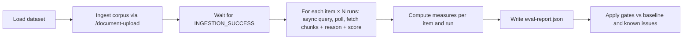

# Design: Standalone end-to-end evaluation suite (DD-43887)

> Stage 02 pipeline artefact — **DRAFT for discussion**. Based on `main @ 9392d3ab`.
> Input: `00-input-brief.md`. A formal `01-requirements.md` has not been written; the
> decisions below marked **(proposed)** and the open questions at the end stand in for it
> until agreed.

## Summary

Add an evaluation suite to `ai-service-orchestration-test` as a separate failsafe profile.
It reuses `RagHarness` (local function hosts, per-run index, containers, queues and tables)
and drives the service only through its HTTP endpoints. It ingests a small, synthetic,
domain-neutral corpus, then runs a set of query items against it. For each item it records
measures for every pipeline stage, and writes a JSON report. Gates are applied once, at the
end of the run, over the whole report, so one failing item never hides the others.

**No function, trigger, binding, env var, table schema or HTTP contract changes in v1.**
Everything the suite measures is already observable through the API or the answer-generation
table. Two gaps (retrieval before dedup/MMR, token usage) are deferred; see "Gaps".

---

## What the service already exposes (verified)

| Need | Source today |
|---|---|
| Ingestion outcome | `GET /document-upload/{documentReference}` → `documentIngestionStatus` |
| Answer text with rendered citations | `llmResponse` from `POST /answer-user-query` (sync) or the async status endpoint |
| Chunks sent to the model (documentId, pageNumber, chunkContent) | `GET /answer-user-query-async-status/{transactionId}?withChunkedEntries=true` → `documentChunks` (`OrchestrationIT.verifyChunkedEntriesReturned`) |
| Citation-degraded reason | Async status response `reason` (`[guard=<mode>] Citations missing: …, invalid=N`) |
| Groundedness score from the scorer | Answer-generation table column read via `TableUtil` (`OrchestrationIT.verifyGroundednessScoreRecorded`) |
| No-evidence answer | The no-data sentinel `OrchestrationIT` already checks for |
| Isolated infrastructure per run | `RagHarness` creates and deletes the index, containers, queues and tables |

Because of the last row, the suite always queries a corpus it ingested itself, with no
leftover documents from other runs.

---

## Decisions

### D1. Where it lives: a profile in `ai-service-orchestration-test` (proposed)

- New package `uk.gov.moj.cp.orchestrator.eval`; new Maven profile `ai-rag-eval`, separate
  from `ai-rag-integration-test` so either can run alone.
- Reuses `RagHarness`, `DocumentIngestionFlow`, `RestPoller`, `TableUtil` and `ContractValidator`.
- Rejected: a new module (duplicates the harness); extending the prompt harness (in-process,
  not end to end, and its job is experiments, not gates).

### D2. Shape: one runner, a report, then gates (proposed)



- Items run as data, not as one JUnit test each. One JUnit test (`RagEvalIT`) runs the loop
  and asserts the gates at the end, listing every breach in a single failure message.
- Queries use the **async** path, because it is the only one that returns the chunks and the
  reason. A small sync sample checks that both paths give consistent results.

### D3. Golden dataset (proposed)

Lives in `src/test/resources/eval/`. Documents are committed as PDFs only, in
`eval/documents/`. All content is synthetic and domain-neutral (fictional organisations,
suppliers and sites).

Each document targets one behaviour:

| Doc | Behaviour under test | Related ticket |
|---|---|---|
| Plain multi-page text | Baseline: facts on known pages | — |
| Two-column page and a table | Reading order and layout | DD-43810 |
| The same passage in two files | Cross-file duplicates collapse | containment dedup |
| A copy of that passage with one extra fact | The superset copy survives dedup | containment dedup |
| Two documents with the same template, different values | Both retrieved, values not mixed up | DD-43811 |
| A scanned (image-only) page | OCR text reaches the index | — |
| Text containing instructions to the model | Instructions in content are not obeyed | — |

Item format (draft):

```json
{
  "id": "plain-001",
  "tier": ["smoke", "full"],
  "query": "What maintenance interval is set for the north pump?",
  "queryPrompt": "default",
  "metadataFilter": [{ "key": "corpus", "value": "eval-v1" }],
  "expectedFacts": [
    { "id": "interval", "type": "duration", "value": "90 days" },
    { "id": "since", "type": "date", "value": "2024-03-14" }
  ],
  "forbidden": [{ "id": "south-pump-interval", "type": "duration", "value": "30 days" }],
  "goldPages": [{ "document": "plain-multipage.pdf", "pages": [4] }],
  "shouldRefuse": false
}
```

- **Typed facts, not hand-written regexes.** Each `type` (date, number, duration, money, text)
  has one shared normaliser that accepts the usual formats. ragEval's regex date patterns
  missed `April 21, 2024`; typed normalisers fix that class of bug once, for every item.
- `goldPages` names documents by file name. The runner maps them to the documentIds it
  generated at ingestion.

### D4. Measures (proposed)

| ID | Stage | Measure | Computed from | v1 |
|---|---|---|---|---|
| M1 | Ingestion | Reaches `INGESTION_SUCCESS` within the timeout | status endpoint | **Gate** |
| M2 | Ingestion | Planted marker strings present in the chunks for their page | `documentChunks` across items | Report |
| M3 | Retrieval | Gold-page recall in the final chunk set | `documentChunks` vs `goldPages` | **Gate** (threshold) |
| M4 | Retrieval | Duplicate passages collapsed; superset copy kept | `documentChunks` | **Gate** |
| M5 | Retrieval | No chunk outside the metadata filter | `documentChunks` | **Gate** (zero tolerance) |
| M6 | Answer | Fact recall | `llmResponse` vs `expectedFacts` | **Gate** (threshold) |
| M7 | Answer | Forbidden content absent | `llmResponse` vs `forbidden` | **Gate** (zero tolerance) |
| M8 | Answer | Refusal correctness (refuses when it should, answers when it can) | `llmResponse`, `shouldRefuse` | **Gate** |
| M9 | Citations | Cited pages are gold pages (citation precision) | rendered citations vs `goldPages` | **Gate** (threshold) |
| M10 | Citations | Citation-degraded rate | `reason` | **Gate** (threshold) |
| M11 | Groundedness | Scorer's groundedness score | answer-generation table | Report |
| M12 | Groundedness | LLM-judged faithfulness to the chunks | judge model, nightly only | Report |
| M13 | Operations | Latency p50 / p95, async time to complete | client-side timings | Report, then threshold |

- **M9 is stricter than the service's own check.** DD-43809 checks that citations point at
  *retrieved* pages. M9 checks that they point at the *right* pages.
- **M3 measures only the final set.** Recall before dedup and MMR needs data the API doesn't
  return (gap G1).
- **M12 is compared with M11.** If they agree, the existing scorer is enough and the judge
  can be dropped.

### D5. Stability, baseline and known issues (proposed)

- **Repeat runs:** each item runs N times (1 on PR, 3 nightly). An item passes a measure if it
  passes in at least ⌈2N/3⌉ runs. The report keeps every run, so variance is visible.
- **Baseline:** `eval/baseline.json` holds the last accepted aggregate scores. A gate fails on
  an absolute threshold **or** on a drop larger than the tolerance against the baseline. The
  baseline only changes in a reviewed commit.
- **Known issues:** `eval/known-issues.json` maps an item and measure to a ticket. Exempted
  results are reported but don't gate. An exemption that starts passing is flagged so it can be
  removed.

### D6. When it runs and what gates (proposed)

**Every merge to `main` cuts a release, and the release build runs with `-DskipTests`.** So
the PR build is the release gate, and the only place a gate can stop a release.

| When | Pipeline | Runs | Gates |
|---|---|---|---|
| **PR** | `context-verify` (already runs ITs against dev Azure) | `smoke` items, N=1 | Deterministic measures, zero-tolerance ones strictly |
| **Nightly / on demand** | Scheduled run (where to be decided, OQ-3) | `full` items, N=3, plus the LLM judge | Report-only; trends against the baseline |

Keeping the PR tier small matters: every item costs ingestion time and LLM calls on every PR.

---

## Gaps (deferred from v1)

| ID | Gap | Option | Proposal |
|---|---|---|---|
| G1 | No view of the candidate pool before dedup and MMR, so we can't tell "not retrieved" from "retrieved, then cut" | A test-only diagnostic output, or a debug log the suite reads | Defer. Revisit if M3 failures can't be diagnosed |
| G2 | Token usage and cost aren't returned by the API | Query App Insights after the run | Defer to the nightly tier |
| G3 | Refusal detection beyond the no-data sentinel (the model may refuse in its own words) | Treat "no rendered citation and no expected fact" as a refusal, or add phrases to the dataset config | Decide in requirements (OQ-4) |

---

## Rollout

1. **Framework and first slice:** dataset loader, runner, report, M1, M3, M6–M10 on about 10
   items. Report-only.
2. **Gates on PR:** add the baseline and the known-issues register; switch the smoke tier to gate.
3. **Nightly tier:** full set, N=3, the LLM judge (M12) and its comparison with M11.
4. **Gaps:** G1 and G2 only if the earlier phases show they are needed.

---

## Open questions

- **OQ-1 Corpus authoring:** who writes and reviews the synthetic documents, and how is the
  scanned page produced (rendered image of a generated page)?
- **OQ-2 Remote target:** should the suite also run against a deployed environment (base URL
  plus the client-identity header) after a release, or only against local hosts?
- **OQ-3 Nightly home:** an ADO scheduled pipeline in this repo, or the existing GitHub Actions
  trial?
- **OQ-4 Refusal detection:** see G3.
- **OQ-5 Thresholds:** starting values for M3, M6, M9 and M10. Proposal: set them from the
  first three report-only runs, then tighten.
- **OQ-6 Judge:** which deployment, and its rate limit on dev. The pilot preferred gpt-5.1
  over gpt-4o-judge.
- **OQ-7 Both client-filtering legs:** run the eval in the enforcement leg only, or in both
  until cut-over?
